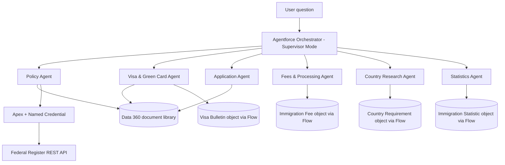

# US Immigration Intelligence

**A multi-agent U.S. immigration research assistant built with Salesforce Agentforce, Data 360, Flow, Apex, and official government information.**

> **Portfolio / educational project.** This application provides general research assistance, not legal advice or a determination of immigration eligibility. Government fees, priority dates, and rules change; verify current information at the linked official sources.

## Overview

US Immigration Intelligence lets a user ask a natural-language immigration question through a coordinating Agentforce agent. In **Supervisor Mode**, the orchestrator delegates relevant parts of the request to six specialist agents, collects their findings, and presents one grounded response.

The application combines:
- **Document grounding:** USCIS policy and form-instruction PDFs indexed through an Agentforce Data Library backed by Data 360.
- **Structured retrieval:** Salesforce custom objects queried by autolaunched Flows.
- **External API research:** An Apex callout to the public Federal Register REST API using a Named Credential.

## Implemented capabilities

| Specialist | Main responsibility | Retrieval / action |
| --- | --- | --- |
| Policy | USCIS policy research and regulatory publications | Data Library retrieval; Federal Register Apex action |
| Visa & Green Card | Visa categories and Visa Bulletin dates | Data Library retrieval; Visa Bulletin Flow |
| Application | USCIS forms and filing guidance | Data Library retrieval |
| Fees & Processing | Filing-fee lookup and general processing-time context | Immigration Fees Flow |
| Country Research | Civil-document requirements by country | Country Requirements Flow |
| Immigration Statistics | Historical USCIS processing-time trends | Immigration Statistics Flow |
| **Orchestrator** | Route multi-topic questions and consolidate responses | Connected agents in Supervisor Mode |

## Architecture

For component detail, see [Architecture](us-immigration-intelligence-docs\docs\ARCHITECTURE.md).

## Portfolio dataset

The implemented demo used **10 USCIS PDFs** and **107 structured records** imported into four Salesforce custom objects:

| Dataset | Demo record count | Main use |
| --- | ---: | --- |
| Visa Bulletin | 30 | November 2026 EB-1/EB-2/EB-3 chargeability charts |
| Immigration Fee | 23 | Selected USCIS filing-fee cases |
| Country Requirement | 12 | Civil documents for India, China, Mexico, Philippines |
| Immigration Statistic | 42 | Historical USCIS processing-time series |

These are **curated snapshots**, not complete or automatically synchronized government databases. The historical processing-time data is not a forecast of current application processing.

See [Government Data Sources](us-immigration-intelligence-docs\docs\DATA_SOURCES.md).

## Demonstrated scenarios

1. **Immigration pathway research:** Explain potential employment-based categories and retrieve policy evidence.
2. **Forms and filing guidance:** Retrieve official instructions for USCIS forms.
3. **Visa Bulletin + filing fees:** Ask one question that invokes both the Visa and Fees specialists; the orchestrator combines their answers.
4. **Country document requirements:** Retrieve civil-document guidance by country.
5. **Historical statistics:** Compare stored processing-time data across fiscal years.
6. **Regulatory publications:** Ask about recent immigration rules; the Policy Agent searches Federal Register documents via Apex.

See [Demo Scenarios and Validation](us-immigration-intelligence-docs\docs\DEMO_SCENARIOS.md).

## Technology

Salesforce Developer Edition · Agentforce Studio / Agent Script · Connected subagents (Supervisor Mode) · Data 360 / Agentforce Data Library · Salesforce Flow · Apex · Named Credentials / External Credentials · Salesforce DX / CLI · GitHub

## Repository structure

The Salesforce metadata retrieved from the development org is stored under `force-app/main/default/` (availability depends on the retrieved metadata and enabled features). This repository's documentation is under `docs/`.

Typical metadata includes custom objects and fields, Flows, Apex classes, permission sets, and Agentforce authoring bundles. **Source retrieval does not export CRM records or uploaded Data Library documents.** Reproducing the demo requires importing the selected public datasets and uploading documents separately.

## Reproducing the project

See [Setup and Deployment](us-immigration-intelligence-docs\docs\SETUP.md) for Salesforce CLI commands, required org configuration, permissions, and manual data provisioning.

## Current status and limitations

- All six specialist agents and the orchestrator were built and tested in a Salesforce Developer Edition org.
- Supervisor Mode was verified by a two-specialist Visa Bulletin + filing-fee question.
- The Policy Agent's Federal Register API action was tested and updated to return abstracts, effective dates (when available), and document numbers.
- The Data Library contains uploaded USCIS files; these source files are not automatically included in Salesforce metadata retrieval.
- Salesforce URL trust settings can cause some generated links to appear as `URL_Redacted`. This issue may require org-specific follow-up.
- The Federal Register search returns a limited set of matching documents, **not** an exhaustive determination that no new regulations exist.
- This project has no public-facing Experience Cloud deployment in the documented scope.

## Official references

- [USCIS Policy Manual](https://www.uscis.gov/policy-manual)
- [USCIS Forms](https://www.uscis.gov/forms/all-forms)
- [USCIS G-1055 Fee Schedule](https://www.uscis.gov/g-1055)
- [Department of State Visa Bulletin](https://travel.state.gov/content/travel/en/legal/visa-law0/visa-bulletin.html)
- [Department of State Visa Reciprocity and Civil Documents](https://travel.state.gov/content/travel/en/us-visas/Visa-Reciprocity-and-Civil-Documents-by-Country.html)
- [USCIS Historical Processing Times](https://egov.uscis.gov/processing-times/historic-pt)
- [Federal Register API Documentation](https://www.federalregister.gov/developers/documentation/api/v1)

## Security and responsible use

No case-status integrations, application submissions, or individual immigration records are required for the demo. Never commit passwords, authentication tokens, Salesforce secrets, signed document-storage URLs, or customer data to this repository. All immigration answers should identify their source and the date/context of the data when relevant.
